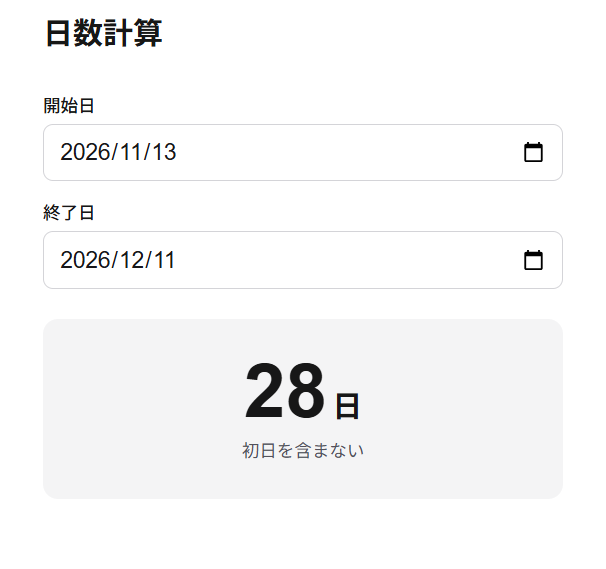

# 日数計算

2つの日付を入れると、その間の日数がすぐに分かるWebアプリです。
締め切りまでの日数を、毎回検索して数えている人のために作りました。

**公開URL：https://day-count-blond.vercel.app**



## できること

- 開始日と終了日をカレンダーから選ぶと、その間の日数を大きく表示します
- 開始日には、最初から今日（日本時間）が入っています
- 日付を変えると、ボタンを押さなくてもすぐに結果が変わります
- スマホ（幅 375px）でも崩れずに使えます

## 計算ルール

- **初日を含みません。** 例：11月9日〜12月18日は39日です
- **日本時間で数えます。** 時刻を含めずに日付だけで計算するので、時差で1日ずれることはありません
- うるう年や月末、年またぎも正しく数えます
- 終了日が開始日より前のときは「〇日前」、同じ日のときは「0日」と表示します

## 技術スタック

| 分類 | 使っているもの |
| --- | --- |
| フレームワーク | Next.js 16（App Router） |
| UI | React 19 |
| 言語 | TypeScript |
| スタイル | Tailwind CSS v4 |
| テスト | Node.js 標準のテストランナー（`node:test`） |
| リント | ESLint（eslint-config-next） |
| 公開 | Vercel |

## ローカルでの起動方法

Node.js 22.18 以上が必要です（テストで TypeScript をそのまま実行するため）。

```bash
npm install
npm run dev
```

ブラウザで http://localhost:3000 を開きます。

## テストの実行方法

```bash
npm test
```

日数計算の関数（`src/lib/day-count.ts`）を、うるう年・月末・年またぎ・終了日が前・同じ日・存在しない日付・日本時間の0時の境目について確かめます。

そのほかのコマンド：

| コマンド | 内容 |
| --- | --- |
| `npm run lint` | ESLint でコードを確認する |
| `npm run build` | 本番用にビルドする |
| `npm run start` | ビルドしたものを起動する |

設計書は [docs/design.md](docs/design.md) にあります。
